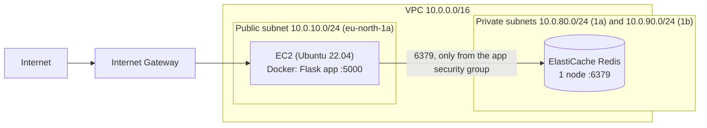
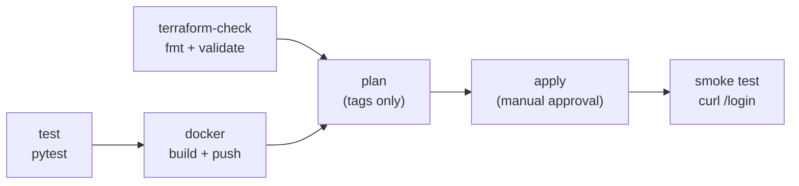
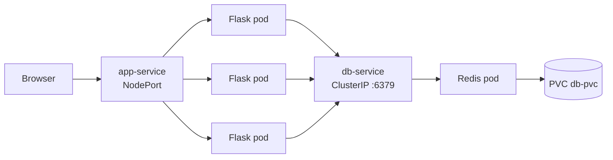

# Task Manager: CI/CD to AWS with Terraform (and Kubernetes)

A small Flask + Redis web app used to practice a complete DevOps workflow: **Git → GitHub Actions (test, build, push) → Docker Hub → Terraform → AWS**, with a second deployment path on **Kubernetes (Minikube)**.

The app is simple on purpose. The project is about the pipeline and the infrastructure around it.

- **Docker image:** `mghzakariae/task-manager`
- **Stack:** Python 3.13, Flask, Redis, Docker, GitHub Actions, Terraform, AWS (VPC, EC2, ElastiCache, S3, IAM/OIDC), Kubernetes (Minikube)

---

## 1. What the app does

- A user logs in with a username (kept in a signed session cookie).
- The user adds tasks and sees their own list.
- Tasks are stored in Redis, one list per user (`<username>:tasks`).

| Route | Method | Purpose |
|---|---|---|
| `/login` | GET, POST | Login form, creates the session |
| `/` | GET, POST | Show tasks / add a task |
| `/logout` | GET | End the session |

> The login is only a username, with no password. It exists to give the app per-user state, not to be a real authentication system.

---

## 2. Two deployment paths

| | Kubernetes (Minikube) | AWS (Terraform) |
|---|---|---|
| Purpose | Learn orchestration: replicas, self-healing, config, storage | Learn IaC and automated delivery |
| App | 3 Flask pods | 1 Docker container on an EC2 instance |
| Redis | Redis pod with a PVC | ElastiCache (managed Redis) in private subnets |
| Deploy | Manual `kubectl apply` | Automated by GitHub Actions on a version tag |

---

## 3. Architecture on AWS



- **VPC module:** VPC, 1 public subnet, 2 private subnets, Internet Gateway, route tables, security groups.
- **Redis module:** ElastiCache subnet group and a single-node Redis cluster. Its security group accepts port 6379 **only from the web app's security group**, and the cluster has no public access.
- **EC2 module:** Ubuntu 22.04 instance. `user_data.sh` installs Docker, pulls `mghzakariae/task-manager:<tag>` and starts it with the config as environment variables.
- **Remote state:** stored in an S3 bucket with encryption and native S3 state locking.
- **Immutable deploys:** `user_data_replace_on_change = true`, so a new image tag replaces the EC2 instance instead of patching it in place. This causes a short downtime during a release.

---

## 4. CI/CD pipeline

Defined in `.github/workflows/docker.yml`.

**Triggers:** push to `main` / `master`, and tags matching `v*.*.*`.



| Job | What it does | Runs on |
|---|---|---|
| `test` | Installs dependencies, runs `pytest` | every push and tag |
| `docker` | Builds the image and pushes it to Docker Hub | after `test` passes |
| `terraform-check` | `terraform fmt -check`, `init -backend=false`, `validate` | every push and tag |
| `plan` | `terraform plan` against AWS | version tags only |
| `apply` | `terraform apply`, then a smoke test that polls `http://<ip>:5000/login` for up to 5 minutes | after `plan`, **needs manual approval** (GitHub `production` environment) |

**Key points**

- **No stored AWS keys.** GitHub Actions authenticates to AWS with **OIDC** by assuming an IAM role (`AWS_ROLE_ARN`).
- **Traceable versions.** The Git tag (for example `v1.0.3`) becomes the Docker tag and is passed to Terraform as `TF_VAR_image_tag`, so you always know which version is running.
- **Approval gate.** Nothing is applied to AWS until a person approves it in the `production` environment.
- **Tear-down.** `.github/workflows/destroy.yml` is a manual workflow that runs `terraform destroy` only if you type `destroy` to confirm.

**Image tags** (from `docker/metadata-action`): branch name, `sha-<commit>`, the Git tag, and `latest` on the default branch.

**GitHub secrets / config used**

| Name | Used for |
|---|---|
| `DOCKERHUB_USERNAME`, `DOCKERHUB_TOKEN` | Push the image |
| `AWS_ROLE_ARN` | OIDC role for Terraform |
| `REDIS_HOST`, `REDIS_PORT`, `SECRET_KEY` | Environment for the test job |

### Release flow

```bash
git commit -am "my change"
git push origin main            # runs test + docker + terraform-check
git tag v1.0.3
git push origin v1.0.3          # also runs plan, then waits for approval, then apply
```

---

## 5. Kubernetes deployment (Minikube)

### Architecture
 


Manifests are in `k8s/`.

| File | Kind | Purpose |
|---|---|---|
| `app-config.yaml` | ConfigMap | `REDIS_HOST`, `REDIS_PORT`, `DEBUG` |
| `app-secrets.yaml` | Secret | `SECRET_KEY` (see warning below) |
| `db-pvc.yml` | PersistentVolumeClaim | 500Mi for Redis |
| `deployment_DB.yml` | Deployment | Redis, 1 replica, volume on `/data`, `--appendonly yes` |
| `servcice-db.yml` | Service (ClusterIP) | Internal access as `db-service` |
| `deployment_app.yaml` | Deployment | Flask app, 3 replicas |
| `service-app.yml` | Service (NodePort) | Exposes the app |

**Why this design**

- Flask and Redis are separate Deployments: the web tier is stateless and scales, Redis holds state and has its own storage.
- All Flask pods share one Redis through its DNS name (`db-service`).
- All pods share the same `SECRET_KEY` (from a Secret), so a session created by one pod is accepted by the others.

> **Warning:** `k8s/app-secrets.yaml` contains a plaintext value. Do not use it for anything real. Create the secret from the command line instead (below) and keep the file out of Git.

### Deploy

```bash
minikube start

kubectl create secret generic app-secret \
  --from-literal=secret-key="$(openssl rand -hex 16)"

kubectl apply -f k8s/app-config.yaml
kubectl apply -f k8s/db-pvc.yml
kubectl apply -f k8s/deployment_DB.yml
kubectl apply -f k8s/servcice-db.yml
kubectl apply -f k8s/deployment_app.yaml
kubectl apply -f k8s/service-app.yml

kubectl get pods
minikube service app-service
```

### Check the cluster behavior

```bash
kubectl delete pod <one-flask-pod>          # self-healing
kubectl scale deployment app-deployment --replicas=5
kubectl delete pod -l app=db                # data should survive (PVC)
kubectl set image deployment/app-deployment tasks-app=mghzakariae/task-manager:<tag>
kubectl rollout undo deployment/app-deployment
```

---

## 6. Run it yourself

### Locally

```bash
docker run -d --name redis -p 6379:6379 redis:7-alpine

cat > .env <<EOF
SECRET_KEY=dev-secret
REDIS_HOST=localhost
REDIS_PORT=6379
REDIS_TLS=false
DEBUG=true
EOF

pip install -r requirements.txt
python app.py        # http://localhost:5000
```

Environment variables: `SECRET_KEY`, `REDIS_HOST`, `REDIS_PORT` and `DEBUG` are required (the app fails at startup if `DEBUG` is missing). `REDIS_TLS` defaults to `false`. Keep it `false` for local Redis and for the ElastiCache cluster in this project, which is created without in-transit encryption.

### Tests

```bash
pytest
```

The tests mock the Redis client (`unittest.mock`), so no Redis server is needed. They cover the redirect to login, the login form and login POST, listing tasks, and adding a task.

### Deploy to AWS with Terraform

Prerequisites: an AWS account, an S3 bucket for the state (edit the bucket name in `terraform/terraform.tf`), an EC2 key pair named `taskManagerApp-SSHkey`, and an IAM role that GitHub can assume through OIDC.

```bash
cd terraform
terraform init
terraform plan  -var image_tag=v1.0.3
terraform apply -var image_tag=v1.0.3
terraform output app_public_ip      # then open http://<ip>:5000
```

> This creates billable resources (EC2 and ElastiCache). Run `terraform destroy` when you are done.

---

## 7. Repository structure

```
.
├── app.py                          # Flask application
├── test_app.py                     # Unit tests (mocked Redis)
├── Dockerfile
├── requirements.txt
├── .env.example
├── .github/workflows/
│   ├── docker.yml                  # test, build/push, terraform checks, plan, apply
│   └── destroy.yml                 # manual terraform destroy
├── k8s/                            # Kubernetes manifests (Minikube)
└── terraform/
    ├── main.tf, terraform.tf, variables.tf
    └── modules/
        ├── vpc/                    # network and security groups
        ├── redis/                  # ElastiCache
        └── ec2/                    # web app instance + user_data.sh
```

---

## 8. What I learned

- CI should fail fast: tests gate the image build, and the image build gates the infrastructure change.
- Credentials should not live in the repo or in CI. OIDC replaced long-lived AWS keys, and config comes from environment variables, Secrets and GitHub secrets.
- Infrastructure split into modules (vpc, redis, ec2) is easier to read, change and reuse.
- A manual approval step between `plan` and `apply` is a cheap and effective safety net.
- Stateless and stateful tiers need different treatment (replicas vs. persistent storage).
- Version tags make releases traceable. `latest` hides what is running.
- The tests mock Redis, so they run in CI without any service. They do not prove that the app works against a real Redis.

---

## 9. Known limitations and next steps

These are known trade-offs of a learning project, not production settings.

- **Security**
  - SSH (port 22) and port 5000 are open to `0.0.0.0/0`. Restrict SSH to my IP or switch to SSM Session Manager.
  - The default `secret_key` in `terraform/modules/ec2/variables.tf` is hard-coded and ends up in the instance's user data. Move it to AWS Secrets Manager or SSM Parameter Store.
  - Traffic is plain HTTP and Redis has no password or TLS.
- **Delivery:** the EC2 instance is replaced on every release, which causes downtime. A load balancer with an Auto Scaling group would allow rolling updates.
- **App:** it runs on the Flask development server (use `gunicorn`), and `pytest` is installed in the production image (split `requirements-dev.txt`).
- **Testing:** add integration tests against a real Redis using a GitHub Actions `services:` container.
- **Kubernetes:** no namespace, probes, resource limits or Ingress yet, and the Redis Deployment should use `strategy: Recreate` with a pinned version.

---

**Author:** Zakaria Mghili